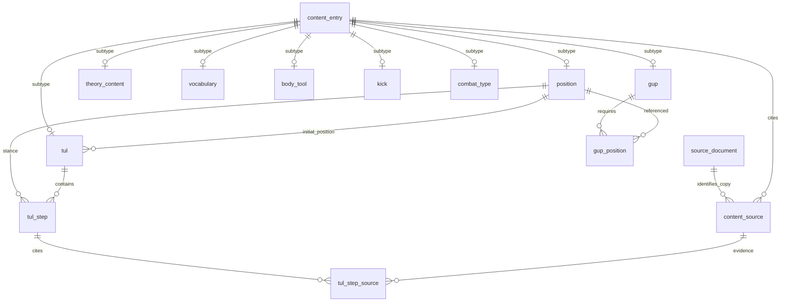

# Persistencia de contenido — primer bloque

Base técnica de la Fase 1 del [plan](../../informe_tecnico.md), no cierre de Sprint 1 ni autorización de publicación. Se implementan PostgreSQL, ubicación definitiva de migraciones Flyway y mapeo de borradores. No hay todavía aplicación Spring Boot.

## Modelo



Las otras seis relaciones curriculares son `gup_theory`, `gup_vocabulary`, `gup_tool`, `gup_kick`, `gup_tul` y `gup_combat`. Cada una referencia su subtipo por FK, sin una relación polimórfica que permita cambiar accidentalmente el tipo requerido.

- `content_entry` centraliza IDs únicos entre catálogos y currículo; FKs compuestas fijan cada subtipo. El importador crea exactamente un subtipo por ficha. La BD no impide por sí sola una fila base sin subtipo/citas: el importador valida primero el conjunto completo, y el futuro servicio deberá conservar esa regla.
- `source_document` conserva la copia exacta por SHA-256; `content_source` exige que ID/hash coincidan. Página PDF y folio impreso son independientes. Triggers comprueban los límites de página también al reducir el total de una fuente.
- Pesos y rotaciones usan `NUMERIC`; desconocido es `NULL`, nunca cero por defecto. No se añaden coordenadas ni medidas no verificadas. La BD no distingue `biomechanics: null` de un objeto con todos sus componentes desconocidos; los JSON originales siguen siendo la fuente editorial.
- Los pasos referencian posiciones y citas del mismo ejercicio. Triggers diferibles comprueban alcance parcial, conteo y continuidad al confirmar una transacción; no prueban corrección marcial. Las identidades de ficha/fuente/paso no se renombran mediante `UPDATE`.
- Todos los registros son **borradores**. El contrato SQL deliberadamente rechaza `approved`: publicación y evidencia de revisión necesitan una migración propia. No hay usuarios, roles, sesiones ni solicitudes implementados en este bloque.
- El inventario JSON conserva cobertura y metadatos completos; su lista orientativa `coverage` no se importa como contenido educativo ni se sustituye por la BD.

## Ejecución local

Dependencias de infraestructura: imágenes PostgreSQL 17.7 y Flyway 11.20.0 (versionadas para reproducibilidad; revisar actualizaciones antes de exponer un servicio). Node 24 reutiliza Ajv existente para validar el exportador; **sin dependencias npm nuevas**. Solo PostgreSQL se publica, en `127.0.0.1`, con volumen persistente. El usuario de bootstrap local no es una credencial de aplicación/producción.

Desde la raíz, copiar `.env.example` a `.env` y completar una contraseña local única. Nunca versionar `.env` ni compartir la salida expandida de `docker compose config`.

```powershell
docker compose up -d postgres
docker compose run --rm migrate
docker compose run --rm migrate validate
powershell -NoProfile -File tools/validators/Test-Database.ps1
```

El test crea una BD aleatoria `tkd_test_<uuid>`, ejecuta las migraciones dos veces, valida checksums, importa los borradores y comprueba restricciones SQL positivas/negativas y preservacion de caracteres UTF-8. Ajusta/restaura la codificacion de PowerShell para no corromper acentos al enviar SQL a `psql`. Elimina solo esa BD de prueba en `finally`. No borra volúmenes ni datos de la BD de aplicación. Requiere Docker Desktop iniciado.

Las migraciones viven en [resources/db/migration](../../backend/taekwonpage-api/src/main/resources/db/migration/). Flyway lleva su historial: no editar una migración ya aplicada, usar una nueva `V2__...sql`. Nunca usar `clean` ni `down -v` para resolver diferencias sin autorización y copia de seguridad.

## Importación

[Exportador](../../tools/seeders/export-draft-sql.mjs): requiere `--local-drafts`; valida todo antes de producir SQL, genera una única transacción y escapa literales explícitamente. No conecta por sí mismo a una BD ni escribe archivos. La prueba integra las 31 fichas y 51 citas actuales en una BD desechable.

No hay seed marcial de producción. Una segunda importación sobre la misma BD falla por duplicados y revierte la transacción: no hace `upsert`, no borra trabajo ni acepta diferencias silenciosas. Cuando exista currículo real, el exportador se detendrá hasta implementar y probar su mapeo. No usar su salida como migración Flyway.

## Falta para cerrar persistencia / comenzar API funcional

1. Prueba PostgreSQL/Flyway ejecutada correctamente el 18-10-2026: migración desde cero, segunda ejecución sin cambios, checksums, importación de 31 fichas/51 citas y 16 rechazos SQL. La BD de desarrollo tiene V1 aplicada sin contenido cargado. Repetir el test al cambiar persistencia.
2. Confirmar programa/revisor y resolver lagunas de contenido antes de declarar cerrado 10º Gup. Esto no impide construir infraestructura local con borradores, pero sí aprobar/publicar o simular un temario completo.
3. Implementar importación curricular, actualización editorial segura y evidencia de revisión/publicación. Verificar integridad con un currículo real; no inventar sus requisitos.
4. Inicializar Spring Boot Java 21, integrar Flyway y repositorios/DTOs, con pruebas de BD y política de acceso antes de exponer contenido. El modelo de identidad/verificación vendrá en su bloque; JWT/OIDC sigue por decidir.
5. Angular consumirá los contratos de API después de ese bloque; no se declara listo un frontend ni una beta por tener tablas.
